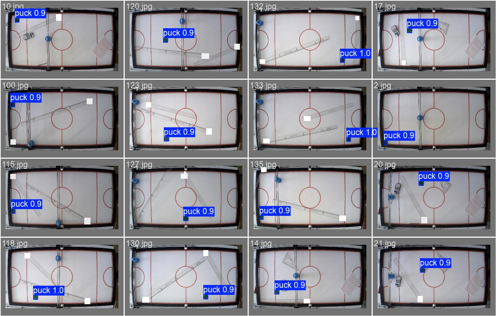
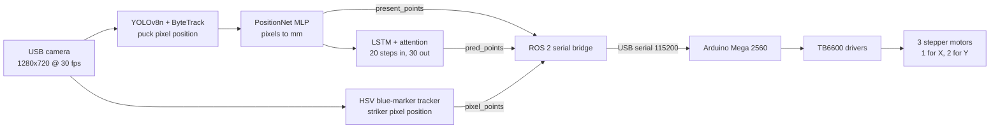
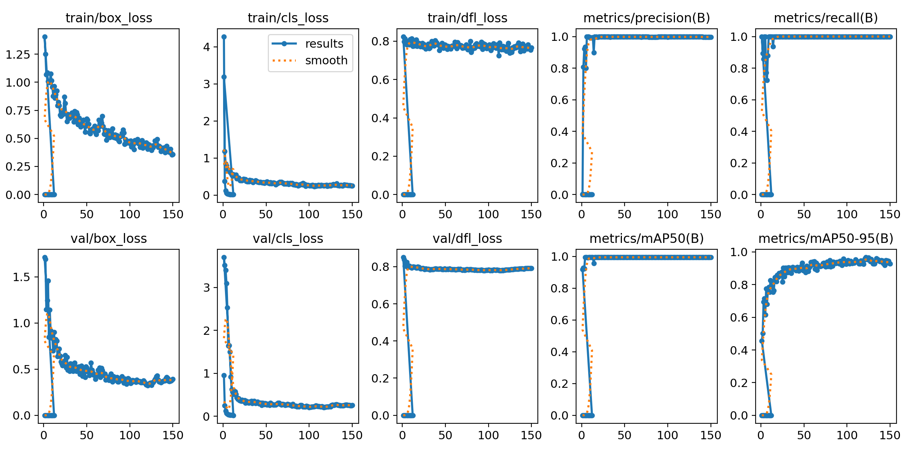
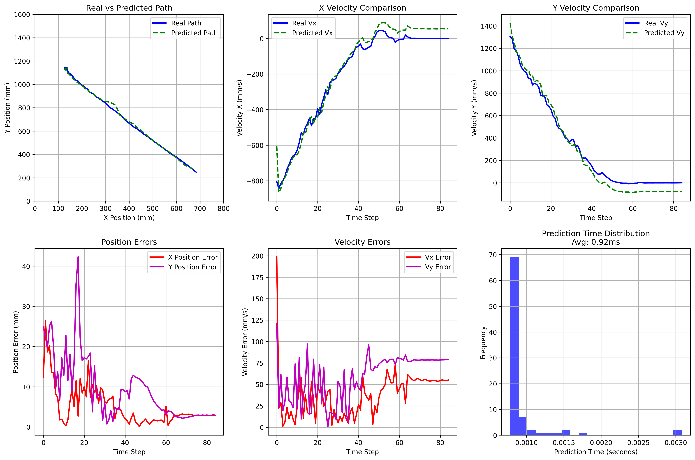

# Hooky Robot

A camera-guided air hockey robot. A USB camera looks down on the table, a YOLO model finds the puck, a small neural network turns pixels into table coordinates, an LSTM predicts where the puck will go, and an Arduino Mega drives the striker along an X/Y gantry with stepper motors.

The repository is a record of how the project grew, from a single stepper on a bench in 2025 to a vision-driven robot in 2026. Every stage of the firmware sits in its own dated folder, so the history reads in order.

> **Status:** research prototype. The vision and prediction stack works end to end on the author's rig. The control loop was tuned by hand for one machine, and several paths and parameters are hard-coded. See [docs/known-issues.md](docs/known-issues.md) before running anything.



*Validation batch of the puck detector (`puck_v2`). The puck is the small green disc. The blue disc on the gantry rails is the striker.*

## Contents

- [How it works](#how-it-works)
- [Hardware](#hardware)
- [Software stack](#software-stack)
- [Data flow and message formats](#data-flow-and-message-formats)
- [Repository layout](#repository-layout)
- [Development timeline](#development-timeline)
- [Getting started](#getting-started)
- [Results](#results)
- [Notes on this repository's history](#notes-on-this-repositorys-history)
- [License and credits](#license-and-credits)
- [Team](#team)

## How it works



1. **Detect.** `main_launching_unit.py` grabs frames from the camera and runs a YOLOv8n model (`puck_v2`, 320 px input) with ByteTrack to follow the puck.
2. **Locate.** The pixel centre of the box goes through `PositionNet`, a 2-16-32-2 MLP trained on 136 calibration points, to give table coordinates in millimetres. Velocity comes from successive positions.
3. **Predict.** Once the puck has moved more than 10 mm, the last 20 states `(x, y, vx, vy)` go into an LSTM with multi-head attention that returns the next 30 states.
4. **Publish.** Three ROS 2 topics carry the results: `present_points`, `pred_points` and `pixel_points`.
5. **Bridge.** A ROS 2 node turns those into a short text line and writes it to the Arduino over USB serial. Several versions of this bridge exist, one per stage.
6. **Move.** The Arduino converts the target into step counts and pulses three TB6600 drivers. It runs proportional-speed control with a dead zone and tracks its own position by counting steps.

## Hardware

| Part | Details |
|---|---|
| Controller | Arduino Mega 2560 (the sketches use Mega pin numbers and port registers) |
| Drivers | TB6600 stepper drivers, 8x microstepping |
| Motors | 3 stepper motors at 200 steps/rev: one on X, two on Y driven in lockstep |
| Drive | Rollers / pulleys of radius 30 mm (30.5 mm from May 2026) |
| Camera | USB webcam over the table, 1280x720 MJPG at 30 fps |
| Host | Linux PC running ROS 2. The code uses CUDA when it is available |
| Table | About 800 x 1600 mm playing surface (from the calibration scripts) |

Pin assignments, the unit conversions and the wiring notes are in [docs/hardware.md](docs/hardware.md).

## Software stack

| Layer | Technology |
|---|---|
| Firmware | Arduino C++, AccelStepper (first tests), direct timer interrupts (2025), micro-ROS (Sept 2025) |
| Middleware | ROS 2 (`ament_python` packages, `rclpy`, `std_msgs/Float32MultiArray`) |
| Vision | Ultralytics YOLOv8n, ByteTrack, OpenCV |
| Learning | PyTorch (position MLP, LSTM with attention), scikit-learn scalers |
| Serial link | pyserial at 115200 baud |

Details of every node, topic and model are in [docs/architecture.md](docs/architecture.md).

## Data flow and message formats

| Topic | Type | Payload |
|---|---|---|
| `present_points` | `Float32MultiArray` | `[frame, x_mm, y_mm, vx, vy]` |
| `pred_points` | `Float32MultiArray` | flat triplets `[frame, x_mm, y_mm, ...]`, up to 30 points |
| `pixel_points` | `Float32MultiArray` | `[cx, cy]` of the blue marker, in pixels |
| `go_to` / `motor_position` | `Float32MultiArray` | September 2025 micro-ROS design only |

The serial protocol to the Arduino changed as the project did:

| Stage | Line sent to the Arduino |
|---|---|
| 2026-04-14 | `velocity_cm_s` |
| 2026-06-01, 2026-06-04 | `x_cm,y_cm` |
| 2026-06-08 | `centre_x,centre_y,pixel_x,pixel_y` |
| 2026-09-16 | `robot_x,robot_y,target_x,target_y` (only the last two are used) |

## Repository layout

```
hooky-robot/
├── firmware/                         Arduino sketches, one dated folder per stage
│   ├── 2025-08-27_timer-interrupt-motor-control/
│   ├── 2025-09-07_trapezoidal-profile-micro-ros/
│   ├── 2026-04-02_first-stepper-driver-tests/
│   ├── 2026-04-14_velocity-control/
│   ├── 2026-05-19_position-control/
│   ├── 2026-06-01_serial-target-and-speed/
│   ├── 2026-06-04_proportional-follow-with-limits/
│   ├── 2026-06-08_pixel-feedback-from-camera/
│   └── 2026-09-16_ball-chasing/
├── ros2_ws/src/
│   ├── arduino_bridge/               ROS 2 package: serial bridge and helper nodes
│   └── yolo_pkg/                     ROS 2 package: vision, prediction, training
│       └── yolo_pkg/codes/
│           ├── main_launching_unit.py      live detection + prediction node
│           ├── bridge_versions/            dated ROS-to-Arduino bridges
│           ├── colour_marker/              HSV blue-marker detector
│           ├── data_collecting/            calibration data and scripts
│           ├── position_model/             pixel-to-mm network
│           ├── full_trajectory_prediction/ LSTM training, models, test plots
│           ├── yolo_for_train/             puck dataset, training script, runs
│           └── tools/                      camera frame grabber
└── docs/                             hardware, architecture, known issues, notes
```

Each firmware stage has its own `README.md` that says what changed and what each sketch does. The scripts under `codes/` are described in [its README](ros2_ws/src/yolo_pkg/yolo_pkg/codes/README.md).

## Development timeline

Dates come from file modification times and from the original `day-month` folder names. The year of the `day-month` folders (2026) is inferred. See [the note on history](#notes-on-this-repositorys-history).

| Date | Stage | What happened |
|---|---|---|
| 2025-07-15 | Data | 136 camera frames of the table plus brightness/occlusion-augmented copies. 136-point workspace calibration set (table mm vs. YOLO pixels). |
| 2025-07-16 | Vision | Puck labelled in CVAT. First YOLOv8n detectors (`puck_v1.1`, `puck_v12`). |
| 2025-08-11 | Tracking | ByteTrack tracker configs (Ultralytics defaults with a 60-frame track buffer). |
| 2025-08-25 | Prediction | First LSTM trajectory model (`20-20-200`) on real-time puck tracks. |
| 2025-08-27 | [Firmware](firmware/2025-08-27_timer-interrupt-motor-control/) | Stepper control from hardware timer interrupts on the Mega: velocity, position and trapezoid ramps. |
| 2025-09-02 | ROS 2 | `arduino_bridge` and `yolo_pkg` packages created. Second LSTM generation (`20-30-300`). |
| 2025-09-04 | Vision | Pixel-to-mm `PositionNet` trained. Final puck detector `puck_v2` (150 epochs). |
| 2025-09-06 | Prediction | Test plots for six model variants, launch file, YOLO training script. A screen recording of a run was made (not in the repo). |
| 2025-09-07 | [Firmware](firmware/2025-09-07_trapezoidal-profile-micro-ros/) | Trapezoidal motion profile with a micro-ROS interface (`go_to`, `motor_position`) and a decision-making ROS bridge. |
| 2025-11-23 | ROS 2 | Generic serial relay (`ros2ard` / `ard2ros`) and a test publisher. |
| 2026-04-02 | [Firmware](firmware/2026-04-02_first-stepper-driver-tests/) | Back to basics with a TB6600: AccelStepper and plain pulse tests. |
| 2026-04-14 | [Firmware](firmware/2026-04-14_velocity-control/) | Serial velocity control for one motor and for the Y pair. |
| 2026-05-19 | [Firmware](firmware/2026-05-19_position-control/) | Go-to-position in centimetres, first X/Y moves. |
| 2026-05-25 | Vision | Camera capture tool, trajectory collector, retrained position model `puck_mm_v1`. |
| 2026-06-01 | [Firmware](firmware/2026-06-01_serial-target-and-speed/) | Non-blocking stepping, `x,y` targets over serial, proportional speed. First ROS bridge for this protocol. |
| 2026-06-04 | [Firmware](firmware/2026-06-04_proportional-follow-with-limits/) | Higher gains, Y limit and home trigger. Bridge that sends the predicted interception point. |
| 2026-06-08 | [Firmware](firmware/2026-06-08_pixel-feedback-from-camera/) | Blue-marker detection publishes pixel coordinates. The Arduino reads four fields per line. |
| 2026-09-16 | [Firmware](firmware/2026-09-16_ball-chasing/) | Arrival flags, step-counted position, and a jitter filter against camera noise. Timer-based bridge. |

## Getting started

Nothing here is a one-command install. The steps below describe what is needed to reproduce each part.

### Firmware

1. Install the Arduino IDE and select **Arduino Mega 2560**.
2. Open the sketch you want from `firmware/<stage>/<sketch>/<sketch>.ino`. Each sketch folder matches its `.ino` name, as the IDE requires.
3. Install libraries where needed: **AccelStepper** (`2026-04-02`) and **micro_ros_arduino** (`2025-09-07`).
4. Set the baud rate to 115200 in the serial monitor and follow the input format in the stage README.

### Vision and ROS 2

```bash
# Python dependencies (inferred from the imports in this repo; versions not pinned)
pip install -r requirements.txt

# Build the ROS 2 packages (Linux, with a ROS 2 distribution sourced)
cd ros2_ws
colcon build --symlink-install
source install/setup.bash
```

Before the live node will run, edit the absolute paths at the top of `main_launching_unit.py`. They point at `/home/humam/hooky/...`, so replace that prefix with your clone's path to `ros2_ws/src/yolo_pkg/yolo_pkg/codes`. The model files they refer to are in this repo:

| Model | Path under `codes/` |
|---|---|
| Puck detector | `yolo_for_train/runs/detect/puck_v2/weights/best.pt` |
| Pixel-to-mm network | `position_model/puck_mm_v1.pt` plus `puck_X_scaler.pkl`, `puck_Y_scaler.pkl` |
| Trajectory LSTM | `20-30-300.pth` and `20-30-300_scaler.pkl` |

The camera index (`/dev/video2`) and the Arduino port (`/dev/ttyACM0` or `ACM1`) are also hard-coded. The entry points in `yolo_pkg/setup.py` and the launch file do not match the current file names yet. All of this is listed in [docs/known-issues.md](docs/known-issues.md).

## Results

**Puck detection (`puck_v2`).** YOLOv8n, 320 px input, 150 epochs, batch 8, trained on CPU in about 24 minutes on 136 labelled frames. At epoch 150 on the validation split: precision 0.997, recall 1.0, mAP@0.5 0.995, mAP@0.5:0.95 0.929. The split is small and the scenes are very similar, so treat these as an upper bound.



**Trajectory prediction.** The LSTM sees 20 steps and predicts 30. Six variants were compared on 26 held-out tracks, named by what looks like input steps, prediction steps and epochs (`20,20,100` through `20 30 300 improved`). The plots for each are in `codes/full_trajectory_prediction/plots/`.



## Notes on this repository's history

- This repository was assembled in October 2026 from a working folder, not from a live git history. The commits are grouped by stage and **their author and committer dates were set to the date of the work**, taken from file modification times. They do not show when the code was pushed.
- The 2026 stages come from folders named `day-month` (`14-4`, `19-5`, `1-6`, `4-6`, `8-6`, `16-9`). The year 2026 is inferred from the file dates.
- Some folders were copied or re-saved later than the work they contain. For example, the `14-4` folder holds timer-interrupt sketches that were written in August and September 2025. The original dates are used here.
- Duplicate files were kept once. For example, `8-6/hooky.zip.ino` and `16-9/hockey_robot.ino` are identical, and one of the two timer sketches named `motors_test_*` is a byte-for-byte copy of the other.
- Left out on purpose: build output, the Python virtualenv, zip archives, a 41 MB screen recording of the September 2025 test, and personal photos.

## License and credits

Code and documentation are released under the [MIT License](LICENSE).

The puck detector is trained with [Ultralytics](https://github.com/ultralytics/ultralytics) YOLOv8, which is licensed under AGPL-3.0. If you redistribute the trained weights or a service built on them, check those terms.

## Team

- [Baraa Lazkani](https://github.com/BaraaLazkani)
- [Humam Yehi](https://github.com/humam-yehi)
- [Hasan Mflh](https://github.com/HasanMflh)

Other people also worked on the project, especially on the YOLO package (`yolo_pkg`: detection, position mapping and trajectory prediction). Their names are not recorded in the original files, so they are not listed here.
